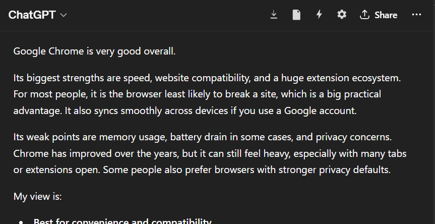
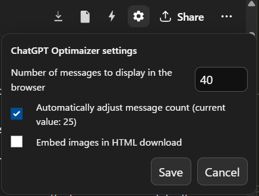
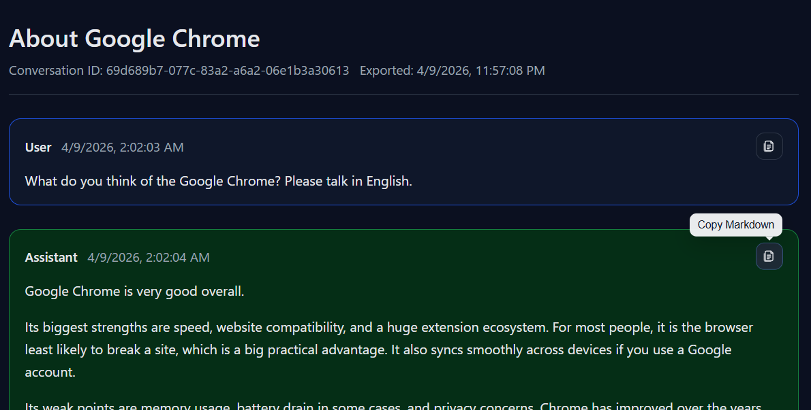
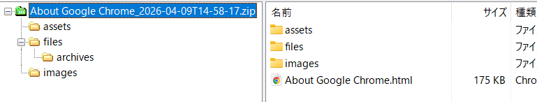
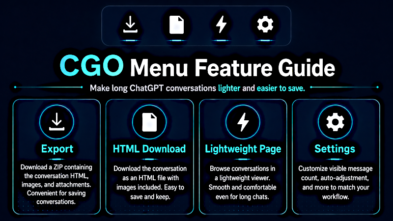

# Conversation Optimizer for ChatGPT 

**Keep the context. Continue the conversation.**

Conversation Optimizer for ChatGPT (CGO) helps you **continue, export, preserve, and revisit long conversations** on ChatGPT Web. Its conversation handoff feature turns the available history of an existing chat into a structured ZIP package that can help a new chat recover the context — even if the original chat can no longer respond.

CGO also provides a lightweight local viewer, standalone HTML exports, and ZIP archives with downloadable assets where available. It works with ChatGPT Web's paginated conversation history and uses your active signed-in session, without an OpenAI developer API key or a CGO account.

> **A conversation can end. Your progress doesn't have to.**

---

## Conversation handoff: pick up where you left off

Have you ever spent days or weeks exploring an idea, debugging a project, or working through an important decision — only to encounter a conversation limit or an error that prevents ChatGPT from replying?

That is especially frustrating if you were about to ask the old chat to write a handoff summary. **CGO does not need the original chat to generate that summary.** As long as the conversation history is still accessible, it can package the available messages for a new conversation.

Rather than relying on a short summary alone, CGO preserves the actual conversation record so the receiving AI can examine **what was decided, why it was decided, what changed, and what remains unresolved**. The package is designed to help the AI understand the history, not automatically execute old instructions.

### How to start a new conversation

1. **Save the handoff package.** In the CGO message area or settings panel, select **Save Handoff ZIP**. CGO downloads a handoff `.zip` and a matching `.zip.sha256` checksum file.
2. **Copy the handoff instructions.** Select **Copy Instructions** in the settings panel to copy a ready-to-use prompt in the current UI language.
3. **Start a new ChatGPT chat.** Attach the handoff ZIP and checksum file, then paste the copied instructions.
4. **Continue your conversation.** The new chat can read the archived history, reconstruct its context, and prepare a cumulative handoff summary where supported. You can then carry on with your next request.

If your earlier conversation produced source code, documents, images, or other important artifacts, **upload those separately as needed**. The handoff package contains the conversation record and attachment metadata, not a guaranteed copy of every original file. The checksum is provided for ZIP integrity verification; the conversation history is in the ZIP itself.

### What's inside the handoff ZIP?

| File | Purpose |
| --- | --- |
| `README.md` | Explains the package structure and how to process the archived conversation |
| `HANDOFF_PROMPT.md` | Ready-to-use handoff instructions in Japanese and English |
| `RECENT_CONTEXT.md` | Recent actual messages for quick orientation |
| `manifest.json` | Message counts, chunk ranges, and package metadata |
| `attachments.json` | References and metadata for attachments mentioned in the conversation |
| `chunks/*.md` | The archived conversation, divided into chronological Markdown chunks |
| `prior/handoff-summary.md` *(when available)* | The latest previously generated cumulative handoff summary, including numbered filename variants, preserved as a checkpoint for the next generation |

The handoff instructions ask the receiving AI to distinguish archived statements from new instructions, reconcile earlier information with later corrections, and report any files or chunks it could not process. Very large conversations may require some chunks to be provided separately.

**Handoff quality depends on the receiving AI and the context it can process.** CGO helps preserve and organize the evidence; it cannot guarantee perfect reconstruction or recover messages and files that ChatGPT Web no longer makes available.

---

## Other features

### Collect and export long conversations

- Detects ChatGPT's paginated conversation format
- Collects older conversation pages gradually while the browser is idle
- Fetches remaining available pages when an export begins
- Shows the collected message count while additional history is loading
- Reconstructs the available conversation in chronological order for export

### Warn when a conversation may be reaching its limits

- Provides advisory warning stages based on previously observed long-conversation behavior, **not** an official or universal conversation limit
- Checks whether the latest assistant response is present in ChatGPT history and warns when it may not have been saved
- Treats stream errors and incomplete stream reconstruction as warning signals
- When ChatGPT reports HTTP 413 `conversation_too_large`, offers a handoff ZIP rather than relying on a migration prompt the old chat may be unable to produce
- Makes handoff export available on demand, without waiting for a warning

### Choose the right export format

| Format | Best for | What it provides |
| --- | --- | --- |
| **Handoff ZIP** | Continuing an existing discussion in a new chat | Chunked conversation history, receiving-agent guidance, recent messages, metadata, and a separate SHA-256 checksum file |
| **Lightweight viewer** | Quickly reopening and reading a conversation | A dedicated local viewer with fast navigation and reading tools |
| **HTML** | Keeping a simple, portable archive | A standalone browser-readable conversation file, with optional embedded images |
| **Standard ZIP** | Preserving the conversation and related files together | HTML plus downloadable images and attachments where ChatGPT makes them available |

**Handoff ZIP and standard ZIP are different exports:** the first is structured for continuing a conversation with an AI; the second is intended for archiving the conversation and its available assets.

### Read and reuse exported content

- Navigate between user messages using the conversation navigator
- Copy individual messages as Markdown
- Copy, collapse, and expand code blocks
- Recreate supported ChatGPT rich response cards, badges, selectors, tables, and sanitized inline SVG graphics
- Review thoughts, generated images, and attachments when that data is available
- Open the original conversation in ChatGPT Web from the exported view

---

## Why CGO changed

CGO was originally created to address a problem with very large ChatGPT conversations. When entire conversations remained loaded and rendered in the browser, pages could become increasingly heavy and difficult to use. Early CGO versions reduced older off-screen content in the DOM to keep long-running conversations practical.

Export features were added during that development: first to revisit content removed from the live page, then as useful tools in their own right. The conversation handoff feature takes that idea further by helping users carry their accumulated context into a new chat.

ChatGPT Web now loads large conversation histories in pages. Because this addresses much of the original browser-load problem, CGO leaves ChatGPT's rendered messages untouched when the current paginated format is detected. Its main role today is **conversation continuity, history collection, and useful local exports**.

The earlier DOM-retention behavior remains only for compatibility with legacy full-conversation response formats. Its settings appear only when that older mode is detected.

---

## How regular exports work

1. Open a conversation in ChatGPT Web.
2. CGO detects the conversation response and adds export tools to the conversation header.
3. For paginated conversations, CGO gradually collects older pages during idle time.
4. Choose the lightweight viewer, HTML, or standard ZIP export.
5. If history is still missing, CGO retrieves the remaining available pages and displays the collected message count.
6. The selected output is generated locally in the browser.

CGO uses the interfaces available to ChatGPT Web rather than the public OpenAI developer API. These web interfaces can change, so occasional compatibility updates may be necessary.

---

## Screenshots

### Conversation header tools

### Settings panel

Settings adapt to the history format detected for the current conversation.

### Lightweight viewer

### ZIP export

### Toolbar guide

---

## Installation

### Chrome Web Store

Install [Conversation Optimizer for ChatGPT from the Chrome Web Store](https://chromewebstore.google.com/detail/conversation-optimizer-fo/chmaignkjgccgmacmlfgnmbfbnnfmnpl).

### From source

1. Download or clone this repository.
2. Open `chrome://extensions/` in Chrome.
3. Enable **Developer mode**.
4. Select **Load unpacked**.
5. Choose this project folder.

The `main` branch contains the latest development version. Stable builds are published through GitHub Releases and the Chrome Web Store. See [Release preparation](docs/RELEASE.md) for packaging notes.

---

## Compatibility

CGO is designed for Google Chrome and is also confirmed to work on Microsoft Edge.

Other Chromium-based browsers may work, but behavior can vary with the browser and with changes to ChatGPT Web.

---

## Privacy

CGO runs locally in the browser and is intended for exporting your own conversation data.

- No CGO account or external CGO service is required
- No OpenAI developer API key is required
- Export data is prepared locally and saved or opened only when you request it
- Requests needed to collect conversation history and files use the active ChatGPT Web session
- Conversation warnings are calculated locally from structural and response-state signals
- Handoff ZIPs are saved locally; **uploading one to a new AI chat shares its contents with that AI service under that service's terms**

See [PRIVACY.md](PRIVACY.md) for the project privacy policy.

---

## Limitations

- CGO depends on ChatGPT Web's internal response formats and endpoints, which may change without notice
- Conversation warnings are advisory and based on observed behavior; they are not official or universal limits
- Export and handoff can include only the history and files accessible through the current ChatGPT session
- Some images, generated files, or attachments may be unavailable because of expired links, access restrictions, unsupported formats, or ChatGPT-side issues
- Handoff ZIPs preserve conversation text and attachment metadata, **not a guaranteed copy of the original attachment files**; important artifacts may need separate upload
- The receiving AI may be unable to process an entire large history at once; follow its request for specific missing chunks if needed
- The paginated format exposes an ordered message history rather than the complete legacy branch graph, so alternate branches or versions may not be reconstructed exactly as before
- Legacy DOM optimization is compatibility behavior and is not used for conversations handled by ChatGPT's current paginated format

---

## License

Conversation Optimizer for ChatGPT is available under the [MIT License](LICENSE).
